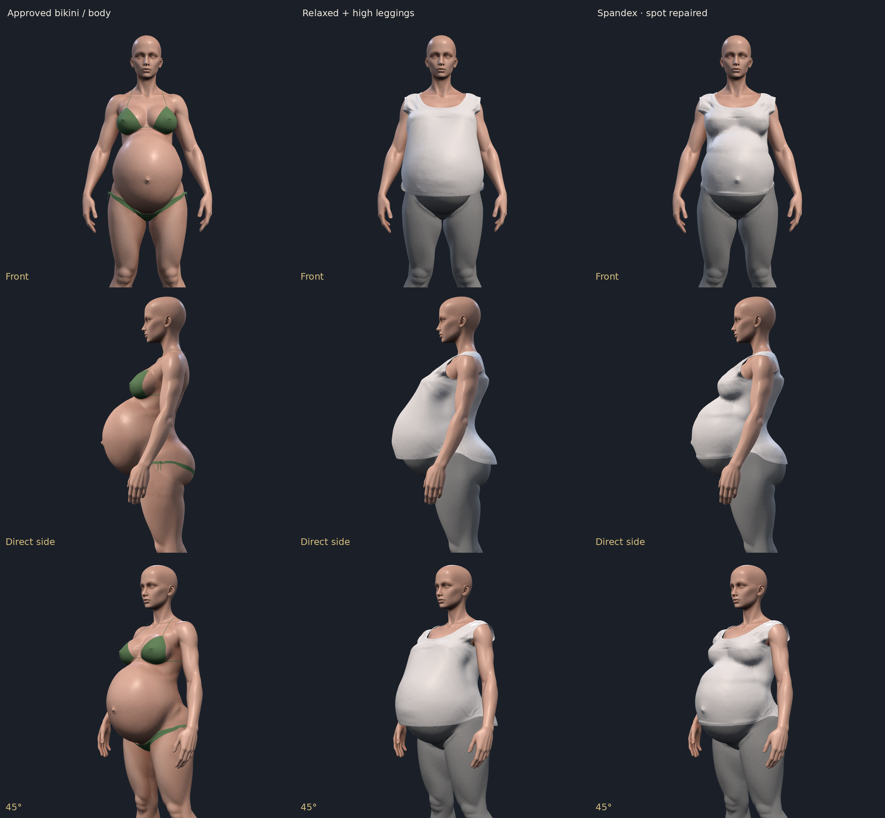
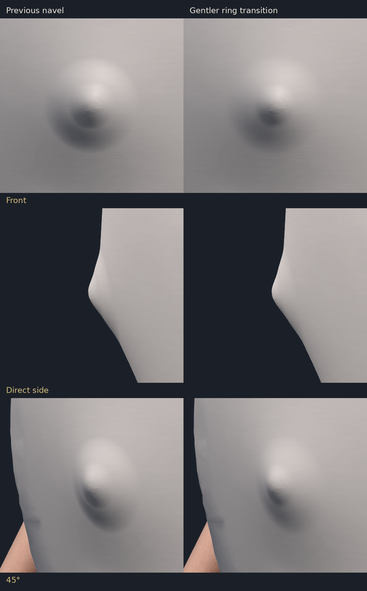
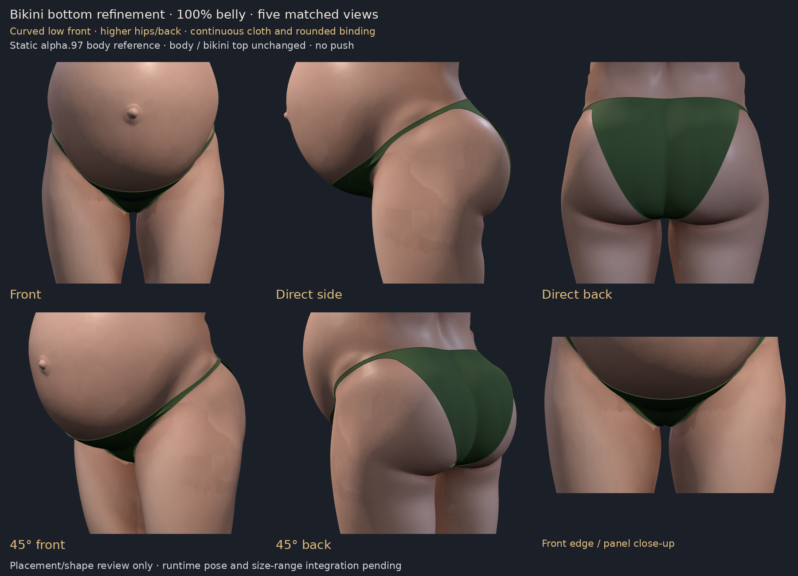

# Sarah v2 work preservation — 2026-10-17 (America/Chicago)

Joshua authorized pushing all work so it cannot be lost, including shirts and
leggings. This branch preserves every currently recovered working source and
review artifact, plus the original recovery archives. It is **not a deployed
alpha.98 build**. Main remains alpha.97 / bcd63ef.

## Included

- The full recovered Relaxed and Spandex shirt preview sources: closer-fit navel,
  local ring shading, chest/shoulder clearance, back edge, soft hem, high-legging
  layering/contour work and abdomen spot corrections. The previous baseline and
  rejected trials remain labeled separately; preserving a trial does not approve it.
- Leggings-related correction sources, mask/occlusion logic, tests and visual
  reviews. High/low leggings in the missing alpha.98 model are not reconstructed.
- The latest reviewed continuous bikini bottom, its two focused tests and five
  matched rendered angles; earlier placement concepts remain as history.
- Meshy's original tank input GLB, unchanged; frozen region measurements and all
  current raw images, manifests and logs in the working snapshot ZIP.
- All four recovered historical review archives, byte-preserved and CRC checked.
- The updated detailed handoff in `scripts/sarahV2Outfit/README.md`.

Readable working code is tracked at the repo's `.scratch/` paths. Representative
review sheets are in `review/`. The ZIP snapshot retains the same `.scratch/`
and `shots/` paths, alongside `inputs/sarah-meshy-tank.glb` and verification logs.
`inventory.json` records exact paths, sizes and SHA256 values for the snapshot
entries and original recovery archives.

## Still missing — do not hide this gap

Workspace maintenance removed unpublished candidate commit **7b1c08c** and its
full alpha.98 runtime/model files. The approved candidate body SHA256 was
`67ff41d30d75ee155d4edc696ebb65c7e987eac8155396089b5535ebbdb9fdc8`.
The historical archives contain code/previews but not that complete candidate.
The reference body in main is
`47e990f0f28097efca488b4274f2cac0e0fa588904bc2c10cb00695600897f42`.

This checkpoint is not proof that missing files were recovered, and must not be
merged into main as a substitute release. Shirt previews are static fit experiments;
the newest bikini is a static 100% T-pose review. Full runtime binding, other poses,
0–200% interpolation and complete outfit checks on the exact candidate remain pending.
Shirt-length sliders remain pending. Approved body/top shapes stay protected.

## Restore and verify

1. Check out this branch (no PR or deployment is involved).
2. Run `python3 recovery/sarah-v2-2026-10-18/restore_archives.py` to reassemble and verify all original ZIPs, then extract `current-working-copy-and-renders.zip` into the repo.
3. Copy `inputs/sarah-meshy-tank.glb` to `/tmp/sarah-meshy-tank.glb` for the frozen
   shirt harness, or adjust its explicit local input path on another machine.
4. Use the lockfile dependencies (`npm ci`). Renderer scripts use this session's
   local Chromium path; adjust only that path for your environment.
5. See each review's README and the detailed handoff before running a trial.
   For the newest bikini: run
   `node --test .scratch/bikini-garment-working/bottom.test.mjs`, then its
   `render.mjs` and `compose.py`. All trials are additive / off by default.

The detailed source handoff and verification logs distinguish current approvals,
rejected experiments, missing files and remaining integration work.

## Checkpoint verification

Fresh checks on this checkpoint: typecheck and build passed; full suite passed
3,752 tests (3 skipped); 38 focused shirt/navel/bikini checks passed. A prior
soil timeout passed both an isolated rerun and this clean full-suite rerun.
All five backup archives pass CRC/SHA256 verification, and all 174 working
snapshot entries match their inventory hashes. No production runtime, model,
lockfile or deployment workflow differs from the parent commit. Frozen archived
sources retain original formatting, including incidental trailing whitespace.

## Review sheets

The prior hip-rise concept is retained in `review/` as historical context.

## Archive transport

The normal git CLI could read the repository but had no write credential. The
authenticated GitHub connection was used instead. Large ZIPs are stored as
4 MiB binary parts in `archive-parts/`; `transport.json` records their order,
size and SHA256 values. `restore_archives.py` reconstructs each original ZIP
without changing its bytes and checks both whole-file SHA256 and ZIP CRC.
Original ZIP names in `inventory.json` refer to those reconstructed files.
No missing candidate file has been substituted.
